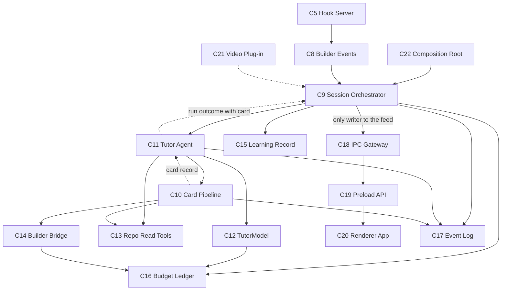

# Application Design: Anti-Vibe Coding (Pi, the learning sidecar)

**Stage:** INCEPTION - Application Design
**Depth:** Standard
**Sources:** requirements.md (approved 2026-11-23; NFR-5.3 reworded 2026-11-25), stories.md (approved 2026-11-24; US-04 reworded 2026-11-25), execution-plan.md, docs/technical-environment.md, `application-design-plan.md` (Q1-Q15), `application-design-clarification-questions.md` (clarification 1)

This document brings together the four detailed design files:

| File | Contents |
|---|---|
| [`components.md`](components.md) | 22 components: purpose, responsibilities, interfaces, source layout, story coverage |
| [`component-methods.md`](component-methods.md) | TypeScript method signatures and types; the rules left to Functional Design |
| [`services.md`](services.md) | Six services and how they orchestrate each flow |
| [`component-dependency.md`](component-dependency.md) | Dependency rules and matrix, communication channels, diagrams, test seams |

Business rules (label thresholds, grading verdicts, cadence details, recovery steps, backup restore) are left to Functional Design for each unit. `component-methods.md` lists them.

## 1. Architecture in one paragraph

Pi is one Electron app on the student's Mac. In the main process, a **Hook Server** on `127.0.0.1` receives Claude Code hook events from a small Node hook script. The script reads a per-launch token from a `0600` runtime file. A **Session Orchestrator** receives every trigger (Builder activity, student responses, End session). It runs a **Tutor Agent** on the pi harness with Haiku 5.5, one run at a time. The agent reads the repo through path-guarded read-only tools, may ask the **Builder Bridge** (`claude -p`, read-only) to confirm an answer key, and proposes one lesson component through `show_component`. A **Card Pipeline** validates the component, snapshots the code it refers to, checks flagged answer keys, and enforces latency limits. The orchestrator applies cadence and caps, records everything in an event-sourced **Learning Record**, and pushes cards to a sandboxed React window over a small typed preload API. Video is a separate plug-in that registers itself only when the student turns it on and the machine passes the checks.

## 2. Key decisions

| # | Decision | Source |
|---|---|---|
| D1 | Feature folders split by process (`src/main`, `src/preload`, `src/renderer`, `src/shared`). `src/components/<type>/` is the one cross-process folder: `schema.ts`, `grader.ts`, `Card.tsx` | Q1 A, Q2 A |
| D2 | Prediction pairing, labels and metrics are pure functions over the learning record. End session is an agent trigger. When the Haiku cap is reached, End session skips the agent and goes straight to the summary | Q3 C, analysis 3 |
| D3 | The agent fills a whole component in one `show_component` call. Its parameters are a union built from the registry | Q4 A, analysis 8 |
| D4 | `TutorModel` has `generateJson` and `runAgent`. A budget decorator wraps it | Q5 A, analysis 9 |
| D5 | Deterministic follow-ups run without the agent. An agent run starts only for new content (follow-up, drill-down question, retest) | Q6 B, analysis 4 |
| D6 | One Session Orchestrator is the only writer to the feed and the record | Q7 A |
| D7 | One agent run at a time. Builder triggers that pile up are merged; responses and End session aren't | Q8 A, analysis 7 |
| D8 | `ask_builder` while writing, plus a pipeline check for cards still flagged. A receipt whose question-and-key hash matches prevents a second Builder call | Q9 C, analysis 5 |
| D9 | IPC uses push events plus `getSnapshot()` | Q10 C |
| D10 | Hook entries run `node pi-hook.mjs`. The token is in a `0600` runtime file with a new token at each launch, never in `settings.json`. The script always exits 0 with no output, with a hard timeout under 200 ms | Q11 B, clarification 1 |
| D11 | Constructor injection with one composition root | Q12 A |
| D12 | The learning record is event-sourced | Q13 A |
| D13 | Each card stores its snippet and file hash. No file watcher; hash compared at grading | Q14 A, analysis 6 |
| D14 | Video is a plug-in, never imported by the main-process core | Q15 A |

**Requirement wording changed in this stage:** NFR-5.3 and the US-04 token criterion now say the token travels in a `0600` runtime file that the hook script reads, not in the hook command (clarification 1). Requirements §3 records the change.

## 3. Components

| ID | Component | Process | Role |
|---|---|---|---|
| C1 | Config | shared | Every prompt, cap, timeout and the concept list; validated at start |
| C2 | Shared Schemas | shared | TypeBox schemas for every boundary |
| C3 | Component Registry | shared, main, renderer | **Contract.** Type definitions, validation, `show_component` union |
| C4 | Lesson Component Types | per type folder | Eight core types: schema, grader, card |
| C5 | Hook Server | main | Fastify on `127.0.0.1`, token and schema checks, `202` at once |
| C6 | Hook Installer | main | Preview, consented merge, backup, removal, hook script, runtime token file |
| C7 | Setup Checks | main | `.env`, repo, Claude Code login, API key |
| C8 | Builder Events | main | Pure normalization, repo filter, merging |
| C9 | Session Orchestrator | main | **Service.** Triggers, queue, cadence, follow-ups, caps, End session |
| C10 | Card Pipeline | main | **Service.** Validate, regenerate once, snapshot, key check, latency limit |
| C11 | Tutor Agent | main | pi harness run with the FR-0.3 tools |
| C12 | TutorModel | main | **Contract.** pi `ModelRuntime` adapter, budget decorator, fake |
| C13 | Repo Read Tools | main | `read`, `grep`, `find`, `ls` with a pure path guard |
| C14 | Builder Bridge | main | **Contract.** Read-only `claude -p`, receipts |
| C15 | Learning Record | main | Event store and pure rules: labels, hints, pairs, metrics, summary |
| C16 | Budget Ledger | main | Reserve and settle accounting for the three caps |
| C17 | Event Log | main | Metadata JSONL; content only in debug |
| C18 | Window Shell and IPC Gateway | main | Hardened window, IPC handlers, push events |
| C19 | Preload API | preload | `window.pi`, nothing else |
| C20 | Renderer App | renderer | Setup screen, feed, status, settings, End session |
| C21 | Video Plug-in | main, renderer | Optional. **Video Runner contract**, checks, queue, `pi-video://` |
| C22 | Composition Root | main | Builds the graph; tests build it with fakes |

The four NFR-7.1 contracts are C3, C12, C14 and the `VideoRunner` in C21.

## 4. Services

| Service | What it coordinates |
|---|---|
| S1 Session Orchestrator (C9) | Trigger intake and run queue, cadence, deterministic follow-ups, caps, status, End session and summary |
| S2 Card Pipeline (C10) | Concept check, schema check and one regeneration, snapshot, answer-key check by receipt or Builder call, latency limit |
| S3 Tutor Agent (C11) | Prompt, tools, run limits, run log |
| S4 Setup and Hooks (C7 with C6) | Launch order, setup steps, consented install, removal, runtime file, quit |
| S5 Hook Intake (C5 with C8) | Token, schema, `202`, repo filter, transcript details |
| S6 Video (C21) | Checks, registration, offers, render queue, fallback to text |

Patterns: single coordinator, serial queue with coalescing, pipeline, decorator, event sourcing, plug-in, and result types instead of exceptions. Full flows are in `services.md`.

## 5. Dependencies



Text alternative:
```
C22 Composition Root builds everything and starts C9.
C5 Hook Server -> C8 Builder Events -> C9 Session Orchestrator.
C9 -> C11 Tutor Agent -> C10 Card Pipeline, C12 TutorModel, C13 Repo Read Tools.
C10 -> C14 Builder Bridge and C13.
Return path (dashed): C10 returns the card record to C11, and C11 returns the run outcome with the card to C9.
C9 is the only writer to the feed: C9 -> C18 IPC Gateway -> C19 Preload API -> C20 Renderer App.
C9 -> C15 Learning Record and C16 Budget Ledger.
C12 and C14 charge C16.
C9, C11 and C10 write run records, drops and rejections to C17 Event Log.
C21 Video Plug-in (optional, dashed) plugs into C9.
```

Rules: one composition root, process boundaries enforced by lint and tsconfig, a pure core for property tests, a single writer for the feed and the record, video as a leaf, no cycles, and nothing writes to the student's repo. The matrix, channels and sequence diagrams are in `component-dependency.md`.

## 6. How the design meets the main requirements

| Requirement | Where |
|---|---|
| FR-0 agent, tools, run end, logging | C11, C12, C13, C14, C10, C17 |
| FR-1 pairing, consent, harmless when closed, never blocking | C5, C6, C8, hook script; S4, S5 |
| FR-2 component system, schema checks, extensibility | C3, C4, C10, C20; `show_component` union from the registry |
| FR-3 concept list, diagnose or explain first, cadence, skips, changed code | C1, C15 `nextLessonHint`, C9 cadence, C10 snapshots |
| FR-4 grading, drill-down, disputes, Builder checks | C4 graders, C9 recovery, C14 receipts, S2 |
| FR-5 before-and-after | C4 prediction, C15 `predictionPairs`, S1 End session |
| FR-6 record, labels, summary, metrics | C15 (event-sourced, pure rules), C4 session-summary |
| FR-7 optional video | C21, S6 |
| FR-8 first-run setup | C7, C6, C20, S4 |
| NFR-1 caps | C16, `BudgetedTutorModel`, C14, C21 |
| NFR-2 latency and preparing indicator | S2 step 5, S1 status |
| NFR-3 retries, loop survives failures | C12 retries, result types in C14 and C21 |
| NFR-4 logging and privacy | C17, app-data only |
| NFR-5 security | C18 window settings, C19, C5 with the token file, C13 guard, C14 flags, argument-array spawns, C2 schemas |
| NFR-7 contracts and config | C3, C12, C14, C21 `VideoRunner`; C1 |
| NFR-8 testing | Test seams and the pure core in `component-dependency.md` |

## 7. Validation

- **Story coverage:** every story US-01 to US-33 and US-V1 to US-V3 maps to at least one component (`components.md`, Story coverage).
- **Contracts:** all four NFR-7.1 contracts are defined with real and fake implementations (`component-methods.md`).
- **Repo safety:** no component writes to the student's repo (dependency rule 7).
- **Consistency with the answers:** each of Q1-Q15, the answer analysis and clarification 1 is reflected in §2 and in the detailed files.
- **Diagrams:** the team ran all six Mermaid diagrams through the Mermaid parser (v11.4.1), and all six parse: three flowcharts (§5 here, and the component overview and learning-record data flow in `component-dependency.md`) and three sequence diagrams (Flows 1 to 3 in `component-dependency.md`). The §5 diagram was then edited to add the return path and C17, and all six were parsed again with Mermaid v11.4.1 (`mermaid.parse`): all six still parse. Each diagram has a text alternative.

## 8. Extension compliance

| Extension | Status at this stage |
|---|---|
| Property-Based Testing (Partial) | N/A: no PBT rule applies at Application Design (rules start at Functional Design). The design keeps the PBT targets as pure functions: schema round-trips (C2, C3), component validation (C3, C10), mastery labels (C15), cap accounting (C16), plus hook merge and remove (C6) and the path guard (C13) from the stories |
| Security Baseline | Disabled (Q30). Skipped. The tech-env §7 controls are covered as NFR-5 (§6 above) |
| Resiliency Baseline | Disabled (Q29). Skipped |
