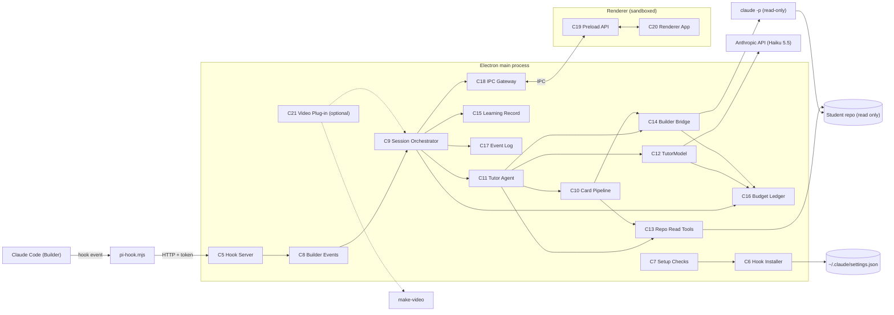
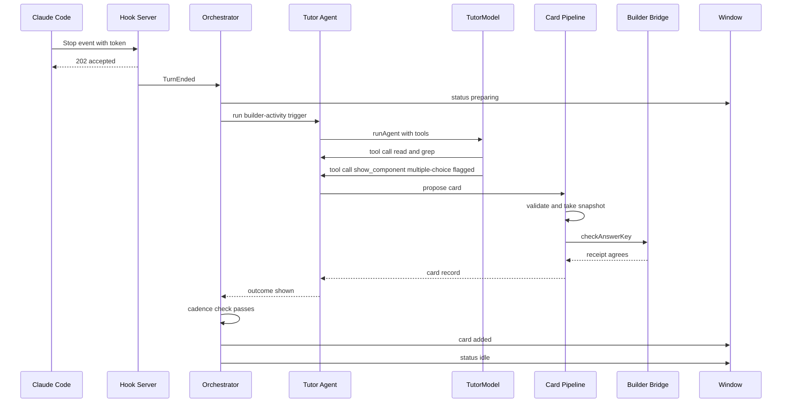
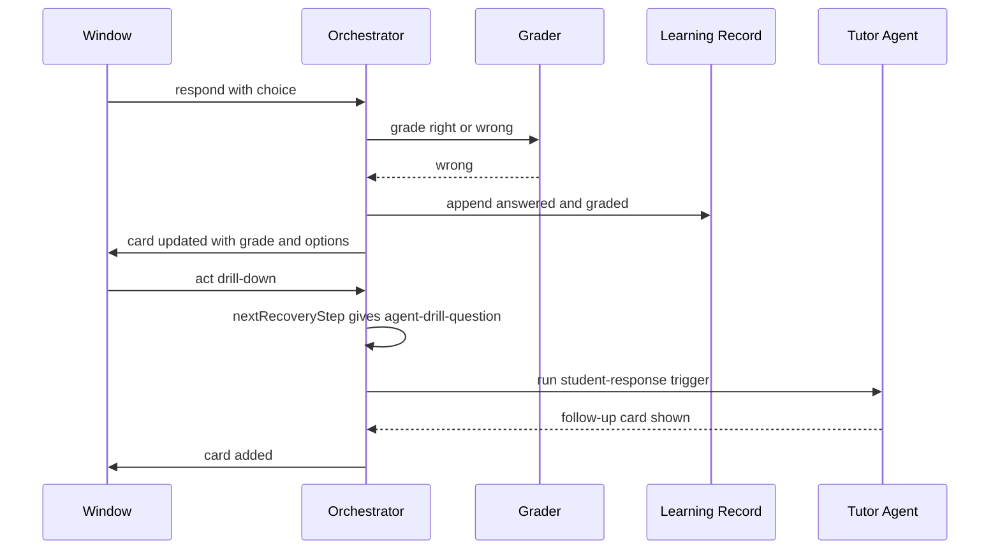
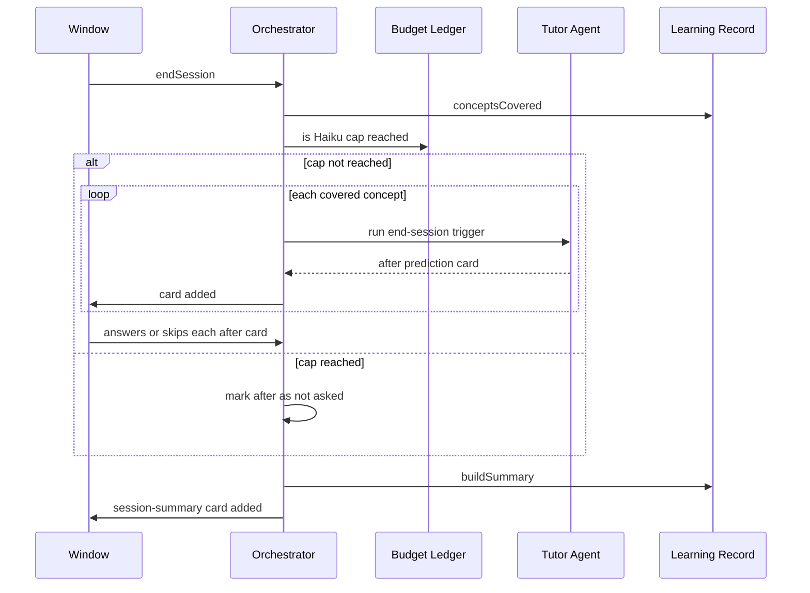
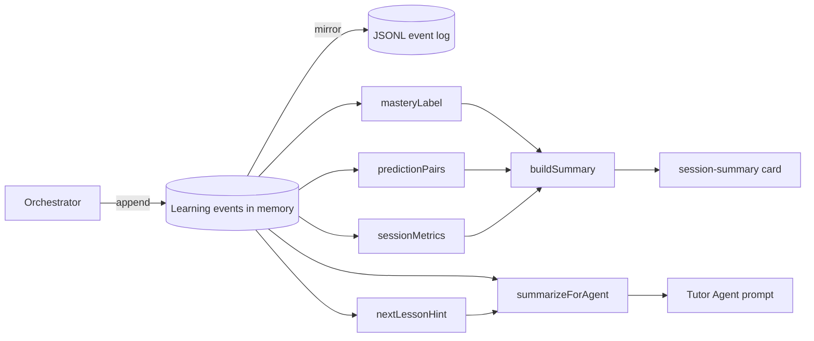

# Component Dependencies

**Stage:** INCEPTION - Application Design
**Sources:** `components.md`, `component-methods.md`, `services.md`, `application-design-plan.md` (Q10, Q11, Q12, Q13 and the answer analysis), `application-design-clarification-questions.md`

## Dependency rules

1. **One composition root (Q12 A).** `src/main/app.ts` builds every main-process component and passes dependencies in through constructors. Only the composition root and the video plug-in loader pick concrete classes. Everything else depends on contracts: `TutorModel`, `BuilderBridge`, `VideoRunner`, `ComponentRegistry`, `FeedSink`, `FileSystem`, `SpawnFn`, `Clock`.
2. **Process boundaries.** Renderer code imports only `src/shared/`, `src/components/*/schema.ts`, `src/components/*/Card.tsx` and `src/renderer/`. Main code never imports `Card.tsx`. Lint import rules and separate tsconfig projects enforce this (Q1 A, Q2 A).
3. **Pure core.** C8, the rules in C15, the accounting in C16, `cadence.ts`, `recovery.ts`, `guardPath`, `mergePiHooks` and `removePiHooks`, `receiptCovers` and `hashAnswerKey` do no I/O. They are the property-based test targets (NFR-8.3).
4. **Single writer.** Only C9 appends to the learning record and calls `FeedSink`. Other components return results to it.
5. **The optional feature is a leaf.** No core component imports `src/plugins/video/`. The plug-in depends on core contracts, never the other way round (Q15 A).
6. **No cycles.** C10 calls C14, never the reverse. C11 calls C10 through the `show_component` tool. C9 calls C11. Callbacks go up only through injected interfaces (`regenerate`, `FeedSink`, listeners).
7. **Nothing writes to the student's repo.** C13 and `RepoReader` only read. C14 runs `claude -p` with read-only tools. C6 writes only to `~/.claude/settings.json` (with consent) and Pi's app-data folder. C17 writes only to Pi's app-data folder.

## Dependency matrix: main-process core

Read across: the row component **depends on** the column component. `●` direct call, `○` through an injected interface or a callback, `·` none.

| depends on → | C1 | C3 | C10 | C11 | C12 | C13 | C14 | C15 | C16 | C17 | C18 |
|---|---|---|---|---|---|---|---|---|---|---|---|
| **C9 Orchestrator** | ● | ● | ● | ● | ○ | · | · | ● | ● | ● | ○ |
| **C10 Card Pipeline** | ● | ● | · | ○ | · | ● | ● | · | · | ● | · |
| **C11 Tutor Agent** | ● | ● | ● | · | ● | ● | ● | · | · | ● | · |
| **C12 TutorModel (budgeted)** | ● | · | · | · | · | · | · | · | ● | · | · |
| **C13 Repo Read Tools** | ● | · | · | · | · | · | · | · | · | ● | · |
| **C14 Builder Bridge** | ● | · | · | · | · | · | · | · | ● | ● | · |
| **C15 Learning Record** | ● | · | · | · | · | · | · | · | · | ● | · |
| **C16 Budget Ledger** | ● | · | · | · | · | · | · | · | · | · | · |
| **C17 Event Log** | ● | · | · | · | · | · | · | · | · | · | · |
| **C18 IPC Gateway** | ● | · | · | · | · | · | · | · | · | ● | · |

Notes:
- C9 → C12 is `○`: the orchestrator passes the model to graders through `GradeInput`; it doesn't call the model itself.
- C9 → C18 is `○`: the orchestrator sees C18 only as `FeedSink`.
- C10 → C11 is `○`: the pipeline calls back into the agent's `regenerate`.

## All components: dependencies and how they talk

| Component | Depends on | Used by | Communication |
|---|---|---|---|
| C1 Config | none | all | Import of a frozen object |
| C2 Shared Schemas | TypeBox | C3, C5, C6, C8, C18, C19, C20 | Import |
| C3 Component Registry | C2, C4 | C9, C10, C11, C20, C21 | In-process calls |
| C4 Lesson Component Types | C2, C12 (graders, through `GradeInput`) | C3 | Registered at startup |
| C5 Hook Server | C2, C17, Fastify | C22 | HTTP on `127.0.0.1` in; callback out to C8 and C9 |
| C6 Hook Installer | C2, C17, `FileSystem` | C7, C18, C22 | File system: `~/.claude/settings.json`, app-data |
| C7 Setup Checks | C6, C12, `SpawnFn`, app-data store | C18, C22 | In-process; `claude auth status` subprocess |
| C8 Builder Events | C2, `FileSystem` (transcript only) | C5, C9 | Pure functions plus one read |
| C9 Session Orchestrator | C1, C3, C10, C11, C15, C16, C17, `FeedSink` | C5, C18, C21 | In-process calls; async run queue |
| C10 Card Pipeline | C1, C3, C13 (`RepoReader`), C14, C17 | C9, C11 | In-process calls |
| C11 Tutor Agent | C1, C3, C10, C12, C13, C14, C17 | C9 | pi agent session in-process |
| C12 TutorModel | C16 (decorator), pi `ModelRuntime` | C4, C7, C11 | HTTPS to the Anthropic API (the only outbound network path) |
| C13 Repo Read Tools | C1, C17, `FileSystem` | C10, C11 | Read-only file system |
| C14 Builder Bridge | C1, C16, C17, `SpawnFn` | C10, C11 | `claude -p` subprocess, argument array |
| C15 Learning Record | C1, C17 | C9 | In-process; pure rules |
| C16 Budget Ledger | C1 | C9, C12, C14, C21 | In-process; listener on cap reached |
| C17 Event Log | `FileSystem`, `Clock` | almost all | Append to JSONL in app-data |
| C18 Window Shell and IPC Gateway | C2, C6, C7, C9, C17, Electron | C22 | Electron IPC (`ipcMain.handle`, `webContents.send`) |
| C19 Preload API | C2, Electron `contextBridge` | C20 | Exposes `window.pi` |
| C20 Renderer App | C2, C3 (renderer half), C4 cards, C19 | none | React; IPC through `window.pi` only |
| C21 Video Plug-in | C1, C3, C9, C11 tool set, C16, C17, `SpawnFn` | C22 (loads it when enabled) | `make-video` subprocess; `pi-video://` protocol |
| C22 Composition Root | all main components | Electron entry | Constructs and starts |

## Communication channels

| Channel | From → to | Format | Guard |
|---|---|---|---|
| Hook HTTP | `pi-hook.mjs` → C5 | JSON `POST /events/claude` with `x-pi-token` | `127.0.0.1` only; token from the `0600` runtime file, new each launch (clarification 1); TypeBox schema |
| Runtime file | C6 → `pi-hook.mjs` | JSON `{ port, token, pid }` in app-data | Mode `0600`; deleted on quit |
| IPC requests | C20 → C19 → C18 | `ipcRenderer.invoke` channels: `feed:getSnapshot`, `card:respond`, `card:act`, `card:addActualResult`, `session:end`, `setup:*`, `hooks:*`, `settings:*` | Each message checked against `IpcRequest` |
| IPC events | C18 → C19 → C20 | `card:added`, `card:updated`, `status:changed`, `setup:changed` (Q10 C) | Schema-typed; no secrets |
| Model calls | C12 → Anthropic API | pi `ModelRuntime`, Haiku 5.5 | Budget decorator; only needed snippets sent (NFR-4.3) |
| Builder calls | C14 → `claude -p` | Argument array, JSON output | Read-only tools; Builder-call cap; timeout |
| Video jobs | C21 → `make-video` | Argument array; `--agent claude` | No `ANTHROPIC_API_KEY` in env; one at a time; video cap |
| Video files | C21 → C20 | `pi-video://<jobId>` | Serves only the video output folder |
| Logs | most → C17 | JSONL in app-data | Content only in debug mode |

## Diagrams

### Component overview



Text alternative:
```
Claude Code -> pi-hook.mjs -> (HTTP + token) -> C5 Hook Server -> C8 Builder Events -> C9 Session Orchestrator
C9 -> C11 Tutor Agent -> C12 TutorModel -> Anthropic API (Haiku 5.5)
                      -> C13 Repo Read Tools -> student repo (read only)
                      -> C14 Builder Bridge -> claude -p (read-only) -> student repo
                      -> C10 Card Pipeline -> C14, C13
C9 -> C15 Learning Record, C16 Budget Ledger, C17 Event Log
C12 and C14 -> C16 Budget Ledger
C9 -> C18 IPC Gateway <-> C19 Preload API <-> C20 Renderer App
C7 Setup Checks -> C6 Hook Installer -> ~/.claude/settings.json
C21 Video Plug-in (optional, dashed) -> C9 and make-video
```

### Flow 1: Claude's turn ends and Pi shows a Builder-checked exercise (J1 step 5)



Text alternative:
```
1. Claude Code sends a Stop event with the token. The Hook Server replies 202 at once.
2. The Hook Server passes TurnEnded to the Orchestrator, which shows "preparing".
3. The Orchestrator starts an agent run. The agent reads code and calls show_component with a flagged multiple-choice card.
4. The Card Pipeline validates it, takes a code snapshot, and asks the Builder Bridge to check the answer key.
5. The receipt agrees, so the card goes back to the Orchestrator, which checks cadence and sends card:added to the window.
6. If the agent had already confirmed the key with ask_builder and the receipt hash matched, step 4 would make no Builder call.
```

### Flow 2: a wrong answer, then drill down (J1 step 6)



Text alternative:
```
1. The window sends the student's choice. The Orchestrator grades it with the type's grader (no agent run) and records it.
2. The card is updated with the grade and the two options: Show me the answer, Drill down.
3. The student picks Drill down. nextRecoveryStep says a new question is needed, so the Orchestrator starts an agent run with a student-response trigger.
4. Show me the answer, skip and dispute are handled without any agent run.
```

### Flow 3: End session



Text alternative:
```
1. The student presses End session. The Orchestrator gets the covered concepts from the record.
2. If the Haiku cap isn't reached, it runs the agent once per concept to show an "after" prediction card, and waits for each to be answered or skipped.
3. If the cap is reached, it skips those runs and marks the concepts "after: not asked (cap reached)".
4. It builds the summary with pure functions (no model call) and shows the session-summary card.
```

### Data flow: the learning record



Text alternative:
```
The Orchestrator appends learning events to an in-memory list, mirrored to the JSONL log.
Pure functions read the list: masteryLabel, nextLessonHint, predictionPairs, sessionMetrics.
summarizeForAgent (using labels and next-lesson hints) feeds the Tutor Agent's prompt.
buildSummary (using labels, prediction pairs and metrics) fills the session-summary card.
```

## Test seams

| Seam | Real | Fake in tests |
|---|---|---|
| `TutorModel` | `BudgetedTutorModel(PiTutorModel)` | `FakeTutorModel` with scripted JSON and tool calls (NFR-8.2) |
| `BuilderBridge` | `ClaudeCliBuilderBridge` | `FakeBuilderBridge` with scripted verdicts |
| `VideoRunner` | `MakeVideoRunner` | `FakeVideoRunner` |
| Hook input | `pi-hook.mjs` posting to C5 | Recorded payloads in `test/fixtures/hooks/` posted to C5 or passed to C8 |
| `FileSystem`, `SpawnFn`, `Clock` | Node and Electron | In-memory file system, recorded spawns, fake clock |
| `FeedSink` | `IpcGateway` | Array recorder |

`createApp(overrides)` builds the same graph for the Playwright end-to-end test, with only the model and Builder faked, or with nothing faked for the opt-in live suite.
