# Unit of Work Dependencies

**Stage:** INCEPTION - Units Generation (Part 2: Generation)
**Sources:** `unit-of-work.md`, component-dependency.md (component matrix and rules), component-methods.md, `plans/unit-of-work-plan.md` (Q4-Q6, CQ1-CQ5, M1-M7)

## Rules

1. **Built in order, depends backward only.** The build order is U1a → U1b → U4 → U3 → U5 → U2 → U6 → U7. A unit depends only on units built before it. When a unit needed code from a later unit, the team's decision rule moved the contract or pure translator into U1a or U1b, or moved the check into the later unit's loop (M1 to M7).
2. **Contracts first.** Every interface a unit consumes from another unit is owned by U1a or U1b, or by an earlier unit. Fakes for the U1a contracts live in `test/fakes/`.
3. **Video is a leaf.** No unit depends on U7. U6 shows the video toggle only when the video plug-in is in the build (reading R7) and bundles the video card slots, but it imports nothing from `src/plugins/video/` (D14). If U7 is dropped, the video-only criteria of core stories are recorded as not applicable (story map, "Rule for a dropped U7").
4. **No cycles** at unit level. This follows from rule 1 and component-dependency rule 6.
5. **One shared edit point.** Every unit after U1a adds its wiring to `src/main/app.ts` (M5). It is the only file more than one unit edits.

## Dependency matrix

Read across: the row unit **depends on** the column unit. `●` uses its code directly, `○` uses only its contract or types, `·` none.

| depends on → | U1a | U1b | U4 | U3 | U5 | U2 | U6 | U7 |
|---|---|---|---|---|---|---|---|---|
| **U1a** Project Skeleton and Contracts | · | · | · | · | · | · | · | · |
| **U1b** Shared Core | ● | · | · | · | · | · | · | · |
| **U4** Lesson Component Types | ● | ● | · | · | · | · | · | · |
| **U3** Tutor Agent and Card Pipeline | ● | ● | ● | · | · | · | · | · |
| **U5** Session and Learning Record | ● | ● | ● | ● | · | · | · | · |
| **U2** Builder Pairing and Setup | ● | ● | · | ● | ● | · | · | · |
| **U6** Desktop Shell and UI | ● | ● | ● | · | ● | ● | · | · |
| **U7** Video *(optional)* | ● | ● | · | ● | ● | · | ● | · |

Everything is below the diagonal, so the build order has no backward dependency.

## What each unit uses from earlier units

| Unit | Uses | Why |
|---|---|---|
| U1b | U1a: C1, C2, `FileSystem`, `Clock`, fakes | C3 uses C2 schemas; C8 reads the transcript through `FileSystem`; C16 reads caps from C1; C17 writes through `FileSystem` and `Clock` |
| U4 | U1a: C2, `TutorModel` interface, `FakeTutorModel`; U1b: C3 | Types register in both halves of the registry. Graders get the model through `GradeInput` |
| U3 | U1a: C1, `TutorModel`, `BuilderBridge`, `RecordSummaryForAgent`, `SpawnFn`; U1b: C3, C8 and the hook fixtures, C16, C17; U4: the exercise types and graders | The `show_component` union needs U4's types (CQ3). The AC-4 review runs recorded fixtures through C8 (CQ5). The budget decorator and Builder calls charge C16 |
| U5 | U1a: C1, C2; U1b: C3, C8 types, C16, C17; U4: graders through the registry; U3: C10, C11 | The orchestrator starts agent runs and grades responses. The record mirrors to C17 |
| U2 | U1a: C2, `SpawnFn`; U1b: C8, C17; U3: `PiTutorModel` (API key check); U5: C9 `handleBuilderEvent` | Hook events reach the orchestrator through C8. Setup makes one real model call |
| U6 | U1a: C2 (IPC messages and events); U1b: C3 renderer half; U4: `Card.tsx` for every type; U2: C6, C7; U5: C9 and the `FeedSink` interface | The window renders cards through the registry, runs setup and hook removal, and receives the feed |
| U7 | U1b: C3, C16, C17; U3: the agent's tool set; U5: C9; U6: the settings toggle and status line | The plug-in registers its tool and types, reserves videos, and is turned on from the window |

## Contracts and their owners

| Contract | Owner | Fake (in `test/fakes/` unless noted) | Consumers |
|---|---|---|---|
| `PiConfig` (C1) | U1a | test config | all |
| Shared schemas and types (C2), including `BuilderEvent`, `Trigger`, `CardView`, `CardPatch`, `StatusView` | U1a | none needed | all |
| `TutorModel` (NFR-7.1) | U1a (interface), U3 (real and budgeted) | `FakeTutorModel` (U1a) | U4, U3, U5, U2 |
| `BuilderBridge` (NFR-7.1) | U1a (interface), U3 (real) | `FakeBuilderBridge` (U1a) | U3, U5 |
| `FileSystem`, `SpawnFn`, `Clock` | U1a | in-memory file system, recorded spawns, fake clock (U1a) | U1b, U3, U2, U7 |
| `RecordSummaryForAgent` | U1a (type), U5 (`summarizeForAgent`) | hand-built summaries in U3's tests | U3, U5 |
| `ComponentRegistry` and `CardRegistry` (NFR-7.1) | U1b | a test-only component type | U4, U3, U5, U6, U7 |
| `BudgetLedger` | U1b | the real ledger (pure) | U3, U5, U7 |
| `EventLog` | U1b | an in-memory log | U3, U5, U2, U6, U7 |
| Recorded hook payloads | U1b | `test/fixtures/hooks/` | U1b, U3, U5, U2 |
| `AgentRunContext`, `RunOutcome` | U3 | none | U5 |
| `FeedSink` | U5 (interface), U6 (`IpcGateway`) | array recorder (U5) | U5 |
| `VideoRunner` (NFR-7.1) | U7 | `FakeVideoRunner` (U7) | U7 only (CQ1) |

## Integration points: how each unit joins the app

Each unit joins `createApp` when it finishes (Q6 A). Units built before U5 are checked at the nearest working entry point, and U5 then runs the full-app check for them (CQ2).

| Unit | Joins the app by | Check when it finishes |
|---|---|---|
| U1a | Creating `createApp` and `AppOverrides` | The app builds, starts and stops with fakes. Config validation refuses a bad value |
| U1b | Wiring C3, C8, C16 and C17 into `createApp` | Every recorded fixture goes through C8 to a typed event or a logged "ignored" |
| U4 | Registering its eight types in both registry halves | Nearest entry: the registry. Every type validates, round-trips, and grades with `FakeTutorModel` |
| U3 | Wiring the agent, pipeline, real model and Builder Bridge | Nearest entry: a recorded fixture through C8 into the Tutor Agent and pipeline. **Live:** the AC-4 review, U4's grader, `claude -p` (two-day limit on AC-4 prompt fixes) |
| U5 | Wiring the orchestrator and record, with a recording `FeedSink` | **Full-app check for U4 and U3:** fixtures through C8, C9, C11, C10, back to C9 and the feed. A failure reopens the unit that caused it |
| U2 | Wiring the hook server, installer and setup checks; writing the runtime file at launch | The real `pi-hook.mjs` posts a recorded payload to C5, and it reaches C9. **Live:** the API key check and `claude auth status` |
| U6 | Replacing the recording `FeedSink` with `IpcGateway`; opening the real window | The app runs with the real window, with the model and Builder faked. The window closes the later checks listed in the story map |
| U7 | Loading the plug-in when videos are on and the checks pass; adding `videoRunner` to `AppOverrides` | Turning videos on registers the tool and types; turning them off removes them. **Live:** `make-video` |
| Build and Test | Running the Playwright end-to-end test, the AC-1 to AC-6 checks and journeys J1 and J2 | Owned by the testing and demo role (Q9). AC-4 runs again here if U3 finished below 90% |

## Critical path

U1a → U1b → U4 → U3 → U5 are strictly sequential: each one is needed by the next, and the answer-key risk (AC-4) sits in U3. U2 and U6 come after the core teaching loop already runs. Because of the one-unit-at-a-time rule (Q8), every unit is on the path, so a slip in any loop moves the rest. The schedule risk is in `unit-of-work.md`.

## Diagram

```mermaid
flowchart LR
    U1a["U1a Project Skeleton and Contracts"]
    U1b["U1b Shared Core"]
    U4["U4 Lesson Component Types"]
    U3["U3 Tutor Agent and Card Pipeline"]
    U5["U5 Session and Learning Record"]
    U2["U2 Builder Pairing and Setup"]
    U6["U6 Desktop Shell and UI"]
    U7["U7 Video (optional)"]
    BT(["Build and Test"])

    U1a --> U1b
    U1b --> U4
    U4 --> U3
    U3 --> U5
    U5 --> U2
    U2 --> U6
    U6 -.-> U7
    U6 --> BT
    U7 -.-> BT
    U4 -.->|live grader check runs in U3| U3
    U3 -.->|full-app check runs in U5| U5
```



Text alternative:
```
Build order (solid arrows; each unit uses the ones before it):
U1a Project Skeleton and Contracts -> U1b Shared Core -> U4 Lesson Component Types
  -> U3 Tutor Agent and Card Pipeline -> U5 Session and Learning Record
  -> U2 Builder Pairing and Setup -> U6 Desktop Shell and UI -> Build and Test
Optional (dashed): U6 -> U7 Video -> Build and Test, only if every core unit is approved by 2026-12-10.
Checks that run in a later loop (dashed): U4's live grader check runs in U3's loop;
the full-app check for U4 and U3 runs in U5's loop.
The full dependency matrix above lists every backward dependency, not only the build order.
```

Validation: the diagram was parsed with the Mermaid parser v11.4.1 (`mermaid.parse`, in the session scratchpad) and parses as `flowchart-v2`. Node IDs are letters and digits only.
