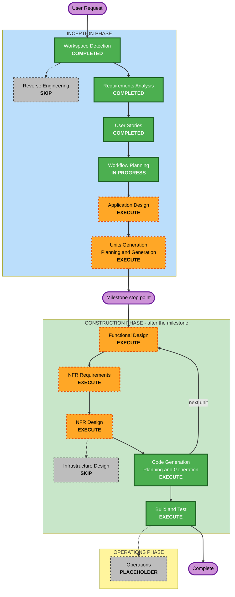

# Execution Plan

**Stage:** INCEPTION - Workflow Planning
**Sources:** `requirements.md` (approved 2026-11-23), `requirement-verification-questions.md` (35 answers), `stories.md` and `personas.md` (approved 2026-11-24), `docs/technical-environment.md`, Run Scope in `aidlc-state.md`

## Detailed Analysis Summary

### Transformation Scope
Not applicable. This is a greenfield project with no existing code.

### Change Impact Assessment
- **User-facing changes:** Yes. Pi is a new desktop app: a setup screen, a feed of lesson components, exercises, drill-down, the End session flow and a session summary (stories US-01 to US-31, US-V1 to US-V3).
- **Structural changes:** Yes. The whole system is new: Electron main and renderer, preload bridge, local hook server, tutor agent on the pi harness, component registry, Builder bridge, optional video runner and the session learning record.
- **Data model changes:** Yes. New TypeBox schemas for hook payloads, IPC messages, model JSON output and every lesson component type, plus the session learning record with mastery labels and before-and-after results (FR-2, FR-5, FR-6).
- **API changes:** Yes. New internal contracts: the hook endpoint on `127.0.0.1`, the typed preload API, and the `TutorModel`, Builder bridge, video runner and component registry contracts (NFR-7.1). Pi also edits the student's user-level Claude Code settings (FR-1.7).
- **NFR impact:** Yes. Cost caps (NFR-1), latency targets (NFR-2), reliability (NFR-3), privacy-aware logging (NFR-4), Electron and tool security (NFR-5) and partial property-based testing (NFR-8.3).

### Risk Assessment
- **Risk level:** High. The system has many components, relies on model output quality (AC-4 needs 90% correct answer keys), depends on external CLIs (`claude -p`, `make-video`) and must fit a two-week build.
- **Rollback complexity:** Easy. Greenfield and in git. The one change outside the repo is the hook entries in `~/.claude/settings.json`, which FR-1.7 and AC-6 require to be removable exactly.
- **Testing complexity:** Complex. Fake `TutorModel` and recorded hook fixtures for unit tests, fast-check properties, Testing Library for renderers, one Playwright Electron end-to-end test, and an opt-in live Haiku suite.

### Points for Application Design to settle
These came up while reading the inputs. They are not decided here.
1. `technical-environment.md` §2 shows `.claude/settings.json` "installed into the student's repo". FR-1.4 overrides this: hooks go in the user-level settings, and the repo is never changed. The design should follow FR-1.4.
2. The same layout lists an `exercises/` folder per interaction type. FR-2 now makes every card a lesson component in one registry, so the folder layout may change.
3. The tech-env §9 open questions about blocking the Builder and window placement are already answered (FR-1.6, FR-3.4). Video machine access is still open, but it doesn't block anything because video is optional.

## Workflow Visualization



### Text alternative

```
Phase 1: INCEPTION (this milestone)
- Workspace Detection ....... COMPLETED (2026-11-19)
- Reverse Engineering ....... SKIP (greenfield)
- Requirements Analysis ..... COMPLETED (2026-11-23)
- User Stories .............. COMPLETED (2026-11-24)
- Workflow Planning ......... IN PROGRESS
- Application Design ........ EXECUTE
- Units Generation .......... EXECUTE
  >> Milestone stop point: stop after Units Generation is approved

Phase 2: CONSTRUCTION (final project, two-week build), repeated per unit
- Functional Design ......... EXECUTE (units with business logic)
- NFR Requirements .......... EXECUTE (light; stack is already chosen)
- NFR Design ................ EXECUTE (units that carry NFRs)
- Infrastructure Design ..... SKIP (runs locally, no cloud resources)
- Code Generation ........... EXECUTE (always)
Then, once for all units:
- Build and Test ............ EXECUTE (always)

Phase 3: OPERATIONS
- Operations ................ PLACEHOLDER
```

## Phases to Execute

### 🔵 INCEPTION PHASE
- [x] Workspace Detection (COMPLETED 2026-11-19)
- [x] Reverse Engineering (SKIPPED: greenfield, no existing code)
- [x] Requirements Analysis (COMPLETED 2026-11-23, Comprehensive)
- [x] User Stories (COMPLETED 2026-11-24: 33 core and 3 video stories, 3 personas)
- [x] Execution Plan (COMPLETED 2026-11-24: this document, approved by the team)
- [x] Application Design - **EXECUTE** (COMPLETED 2026-11-25, approved by the team)
  - **Rationale:** Every component is new, and their methods and dependencies need defining: hook server, tutor agent and its tools, component registry and renderers, Builder bridge, video runner, learning record, config module, preload API. NFR-7.1 also asks for four contracts that have to be designed. The team's Run Scope requires this stage.
  - **Depth:** Standard. Define the components, their methods and the contracts between them. Detailed business rules are left to Functional Design.
- [x] Units Generation - **EXECUTE** (COMPLETED 2026-11-25, approved by the team: 8 units, 36 stories mapped)
  - **Rationale:** The system is too large for one unit in a two-week build. Several parts can be built and tested on their own behind contracts (fake `TutorModel`, recorded hook fixtures). Teammates need parallel work and a build order. The team's Run Scope requires this stage.
  - **Depth:** Standard. Every core and video story must map to a unit (`unit-of-work-story-map.md`), and the video unit stays optional and separable.

### 🟢 CONSTRUCTION PHASE (after the milestone; not started in this run)
- [ ] Functional Design - **EXECUTE** (per unit, where the unit has business logic)
  - **Rationale:** There are new data models (component schemas, learning record) and rule-based logic: mastery labels (FR-6.2), grading and drill-down (FR-4), cap accounting (NFR-1), the before-and-after check (FR-5), cadence (FR-3.3). The PBT extension's PBT-01 (advisory) asks for testable properties at this stage. A unit with no business logic, such as pure wiring, may skip it. That choice is made per unit at the time.
- [ ] NFR Requirements - **EXECUTE** (per unit, light)
  - **Rationale:** The stack is already chosen in `technical-environment.md`, but the NFRs still have to be assigned to units: cost caps, latency targets, the Electron security settings and the hook-server token. The PBT extension's PBT-09 (framework selection, **blocking** in Partial mode) applies at this stage, so skipping it would leave a blocking rule with no stage to satisfy it.
- [ ] NFR Design - **EXECUTE** (per unit that carries NFRs)
  - **Rationale:** Several NFR patterns have to be placed in the design: retry and recovery for model calls (NFR-3.1), keeping the teaching loop alive when the Builder or video runner fails (NFR-3.2), one schema-validation boundary (NFR-5.6), path and secret filtering in the read tools (NFR-5.4), the CSP and sandbox (NFR-5.1), and logging that switches with the debug setting (NFR-4).
- [ ] Infrastructure Design - **SKIP**
  - **Rationale:** Pi runs only on the student's laptop, with no hosted backend, no cloud resources and no infrastructure as code (NFR-6.2, tech-env §3). The local items (Electron Forge setup, hook entries in user settings, the `.env` file) are covered by Application Design, Code Generation and Build and Test.
- [ ] Code Generation - **EXECUTE** (ALWAYS)
  - **Rationale:** Plan and write each unit's code and tests. PBT-02, PBT-03, PBT-07 and PBT-08 (blocking) apply to the tests written here.
- [ ] Build and Test - **EXECUTE** (ALWAYS)
  - **Rationale:** Build instructions, Vitest and fast-check suites, the Playwright Electron end-to-end test, and checks for AC-3 to AC-6.

### 🟡 OPERATIONS PHASE
- [ ] Operations - PLACEHOLDER
  - **Rationale:** Future deployment and monitoring workflows. Pi runs from source and is never deployed.

## Package Change Sequence
Not applicable (greenfield). The build order of the units is decided in Units Generation.

## Estimated Timeline
- **Total stages:** 13. 6 completed (Workspace Detection, Requirements Analysis, User Stories, Workflow Planning, Application Design, Units Generation), 5 to execute in Construction (Functional Design, NFR Requirements, NFR Design, Code Generation, Build and Test), 2 skipped (Reverse Engineering, Infrastructure Design). Operations is a placeholder and is not counted.
- **This milestone (due 2026-11-24, 11:59 PM):** Workflow Planning, Application Design and Units Generation. Each has a team approval and a checkpoint commit.
- **Construction (final project, due 2026-12-16):** the two-week build window from the Run Scope. Functional Design, NFR Requirements, NFR Design and Code Generation run once per unit, then Build and Test runs once. The number of units, and so the per-unit schedule, is set in Units Generation.

## Success Criteria
- **Primary goal:** A working Pi that explains Claude Code's work and checks the student's understanding, without ever writing to the student's repo, shown in a live demo on the WebSocket chat app (AC-1, AC-2).
- **Key deliverables:**
  - Inception (this milestone): `execution-plan.md`, the `application-design/` files, `unit-of-work.md`, `unit-of-work-dependency.md`, `unit-of-work-story-map.md`
  - Construction (final project): source code at the repo root, tests, build and test instructions
- **Quality gates:**
  - Team approval at every stage, logged in `audit.md`, with a checkpoint commit and context reset at each gate
  - Every story maps to exactly one unit before Construction starts
  - PBT Partial: PBT-09 met at NFR Requirements; PBT-02, 03, 07 and 08 met at Code Generation
  - AC-3 to AC-6 pass at Build and Test
  - Construction does not start in this run (milestone stop point)
